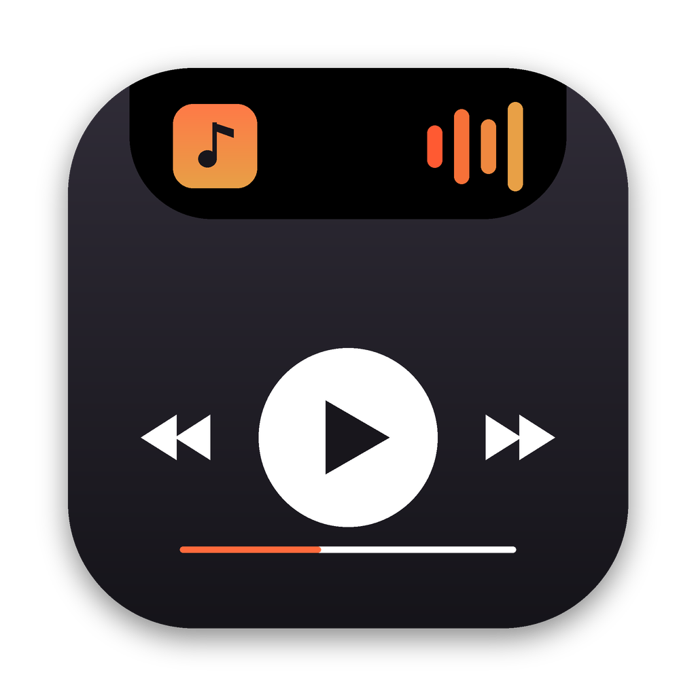
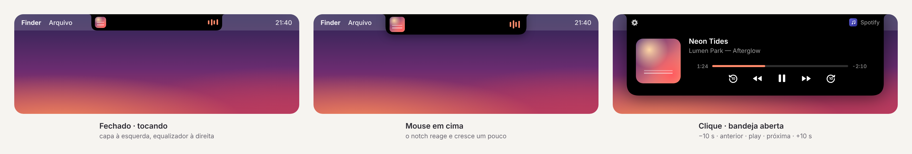
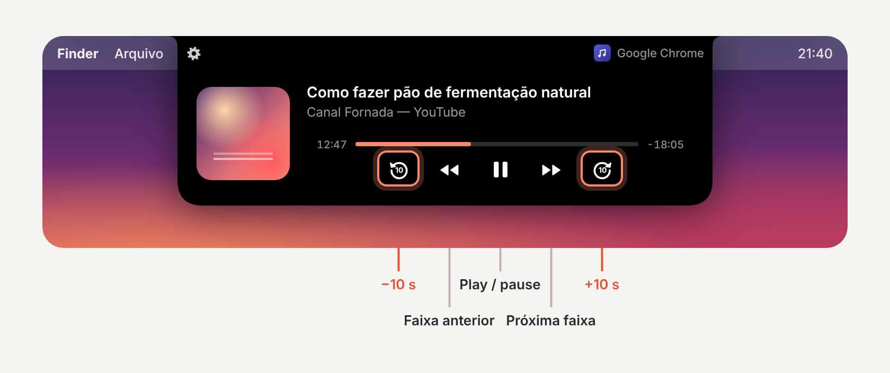

  

<h1 align="center">Notchbar</h1>

  <b>Seu notch, vivo.</b> 
  A música do Mac a um passar de mouse — Spotify, Música, YouTube no navegador, qualquer app.

  
  

  
  
  
  
  

  <a href="#todas-as-versões"><b>Todas as versões e notas de lançamento →</b></a>

  

---

<!-- NEWS:START -->
## Novidades da 1.2.2

#### Melhorias
- Quando o servidor de licenças não reconhece a key, o Notchbar agora diz isso (“Key não reconhecida pelo servidor”) em vez de pedir para conectar à internet.
- **Remover licença deste Mac** passa a liberar a vaga no servidor também quando a licença estava aguardando confirmação online.

#### Notas
- Licença vitalícia cobre toda a série 1.x.

[Notas completas](https://github.com/andrecamellini01-ai/BigHeadStudios.Notchbar-releases/blob/main/release-notes/v1.2.2.md) · [Todas as versões](#todas-as-versões)
<!-- NEWS:END -->

## Escondido no notch. Vivo quando você precisa.

O Notchbar mora no notch do MacBook e não ocupa nada da tela. **Passe o mouse** e ele reage com uma expandidinha. **Clique** e uma bandeja desliza por trás do notch com a capa, o nome da música, o artista, a barra de progresso e os controles.

## Dynamic Island no Mac

Tocou algo? Com o notch fechado, a **capa aparece à esquerda** e um **equalizador à direita**, na cor do álbum. Pausou, e alguns segundos depois tudo volta a sumir no notch.

## Tudo o que toca no Mac

| | |
|---|---|
| **Spotify, Música, Podcasts** | capa, título, artista, álbum |
| **Chrome, Safari, Arc, Edge, Firefox** | YouTube, SoundCloud, Deezer web, cursos, podcasts no navegador |
| **Controles** | −10 s · anterior · play/pause · próxima · +10 s · arraste a barra para pular |

Se aparece na Central de Controle do macOS, aparece no Notchbar.

## Pule 10 segundos, em qualquer player

**−10 s** e **+10 s** ao lado de faixa anterior e próxima — no Spotify, no Música, num podcast ou num vídeo do YouTube no navegador. Toques seguidos somam (3 toques = 30 s). Se o player não deixa pular (uma transmissão ao vivo, por exemplo), os botões ficam apagados.

  

## Nada atrás do notch

Nenhum botão, texto ou capa fica escondido atrás da câmera: tudo vive dos lados e abaixo do notch. As configurações ficam no canto superior esquerdo da bandeja aberta.

Em monitor externo ou num Mac sem notch, aparece um notch virtual (dá para desligar).

## Instalar em 1 minuto

1. [**Baixe o Notchbar.dmg**](https://github.com/andrecamellini01-ai/BigHeadStudios.Notchbar-releases/raw/main/Notchbar.dmg), abra e arraste o Notchbar para **Aplicativos**.
2. Abra o app. O macOS vai bloquear na primeira vez — clique em **OK**.
3. Vá em **Ajustes do Sistema › Privacidade e Segurança**, role até **Segurança** e clique em **Abrir Mesmo Assim**.
4. Na janela seguinte, clique em **Abrir**. A bandeja aparece no notch para mostrar onde o Notchbar mora.

<b>Por que o macOS bloqueia na primeira vez?</b>

 
O Notchbar é distribuído fora da App Store. O macOS pede que você aprove uma vez qualquer app baixado dessa forma. As atualizações seguintes instalam por dentro do app, sem esse passo.

## Preço

| | Teste | Vitalícia |
|---|:---:|:---:|
| **Preço** | grátis | **US$ 2,99** — pagamento único |
| **Duração** | 48 horas | para sempre |
| **Todos os recursos** | ✓ | ✓ |
| **Atualizações 1.x** | — | ✓ |
| **Macs** | 1 | até 2 |
| **Funciona offline** | ✓ | ✓ (confirma online na ativação) |

<!-- TROQUE o link abaixo pelo seu checkout (Stripe Payment Link, Lemon Squeezy, Gumroad…) -->
**[Comprar licença vitalícia →](COLE_AQUI_O_LINK_DO_CHECKOUT)**

A key chega no e-mail da compra. No Notchbar: abra a bandeja › ícone de ampulheta › cole › **Ativar** (precisa de internet nessa hora).

## Privacidade

- **Nenhuma permissão:** nem Acessibilidade, nem Gravação de Tela, nem Automação.
- Lê o mesmo “Tocando agora” da Central de Controle, **só no seu Mac**.
- Nada de conta nem analytics. Rede: a checagem diária de atualização (um arquivo estático neste repositório) e a confirmação da licença — só a key, um código do Mac (hash), o nome do Mac e a versão do app.

## Todas as versões

Cada versão continua disponível para download, com as suas notas. O app avisa sozinho quando sai uma nova (ícone verde no canto da bandeja) e se atualiza por dentro, conferindo a integridade do download.

<!-- VERSIONS:START -->
| Versão | Data | Download | Notas | SHA-256 |
|---|---|---|---|---|
| **1.2.2** **(atual)** | 15/10/2026 | [Notchbar-1.2.2.dmg](https://github.com/andrecamellini01-ai/BigHeadStudios.Notchbar-releases/raw/main/versions/Notchbar-1.2.2.dmg) | [v1.2.2](https://github.com/andrecamellini01-ai/BigHeadStudios.Notchbar-releases/blob/main/release-notes/v1.2.2.md) | `7c746af721d3…` |
| **1.2.1** | 15/10/2026 | [Notchbar-1.2.1.dmg](https://github.com/andrecamellini01-ai/BigHeadStudios.Notchbar-releases/raw/main/versions/Notchbar-1.2.1.dmg) | [v1.2.1](https://github.com/andrecamellini01-ai/BigHeadStudios.Notchbar-releases/blob/main/release-notes/v1.2.1.md) | `2401340eaa33…` |
| **1.2.0** | 15/10/2026 | [Notchbar-1.2.0.dmg](https://github.com/andrecamellini01-ai/BigHeadStudios.Notchbar-releases/raw/main/versions/Notchbar-1.2.0.dmg) | [v1.2.0](https://github.com/andrecamellini01-ai/BigHeadStudios.Notchbar-releases/blob/main/release-notes/v1.2.0.md) | `0ca48df14b0e…` |
<!-- VERSIONS:END -->

## Perguntas frequentes

<b>Funciona no meu Mac sem notch?</b>

 
Sim. O Notchbar desenha um notch virtual no topo da tela, que se comporta igual.

<b>Some quando eu uso um app em tela cheia?</b>

 
Sim, de propósito: em tela cheia o Notchbar sai do caminho.

<b>O que acontece depois das 48 horas?</b>

 
A bandeja passa a mostrar só “Ativar licença” e “Comprar”. Cole a key e tudo volta na hora.

<b>Em quantos Macs posso usar?</b>

 
Em até **2 Macs** seus ao mesmo tempo. Trocou de Mac? No antigo: Licença › Remover licença deste Mac — a vaga fica livre para o novo.

---

© 2026 BigHeadStudios. Notchbar é independente, sem afiliação com a Apple ou com os apps que controla. Leitura de mídia via <a href="https://github.com/ungive/mediaremote-adapter">mediaremote-adapter</a> (BSD-3-Clause).
